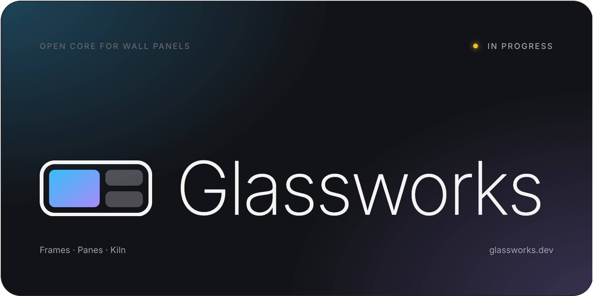

  

<b>The open core for Home Assistant wall panels.</b>

Dashboard, ESPHome device, setup and updates for any wall panel. Everything else is a pane: voice,
music, Zigbee/Thread, or one you write.

> [!NOTE]
> Not released yet. Glassworks is being split out of
> [S1 Unleashed](https://github.com/aguilaair/aqara-s1-unleashed), which installs on the Aqara S1
> Plus today.

### How it fits

| | |
|---|---|
| **Frame** | One per device. Everything hardware-specific lives here. |
| **Pane** | A plugin. Declares the hardware it needs. |
| **Kiln** | The installer. Runs in the browser, over USB. |

### Frames

| Device | Status |
|---|---|
| Aqara S1 Plus | Works today, as [S1 Unleashed](https://github.com/aguilaair/aqara-s1-unleashed) |
| Sonoff NSPanel Pro and T6E rebadges | Planned |
| Generic Android | Planned |

### Why Apache-2.0

Most full-featured panel apps are closed or non-commercial. Glassworks lets you port it to your
device, fork it, and ship panels that run it.

Home Assistant is a trademark of the Open Home Foundation. Glassworks isn't affiliated with it.
