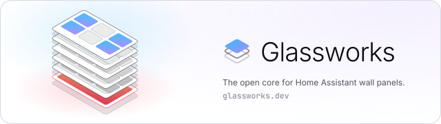

  <a href="https://www.glassworks.dev">
    <picture>
      <source media="(prefers-color-scheme: dark)" srcset="banner-on-dark.svg">
      
    </picture>
  </a>

Dashboard, ESPHome device, setup and updates for any wall panel. Everything else is a pane: voice,
music, Zigbee/Thread, or one you write.

> [!NOTE]
> Not released yet. Glassworks is being split out of
> [S1 Unleashed](https://github.com/GlassworksHQ/aqara-s1-unleashed), which installs on the Aqara S1
> Plus today.

### How it fits

<table>
  <tr>
    <td>
      <picture>
        <source media="(prefers-color-scheme: dark)" srcset="icon-frame-on-dark.svg">
        
      </picture>
      <b>Frame</b>
    </td>
    <td>One per device. Everything hardware-specific lives here.</td>
  </tr>
  <tr>
    <td>
      <picture>
        <source media="(prefers-color-scheme: dark)" srcset="icon-core-on-dark.svg">
        
      </picture>
      <b>Core</b>
    </td>
    <td>What every panel needs. No device code.</td>
  </tr>
  <tr>
    <td>
      <picture>
        <source media="(prefers-color-scheme: dark)" srcset="icon-pane-on-dark.svg">
        
      </picture>
      <b>Pane</b>
    </td>
    <td>A plugin. Declares the hardware it needs. <a href="https://www.glassworks.dev/panes">See the panes</a></td>
  </tr>
  <tr>
    <td>
      <picture>
        <source media="(prefers-color-scheme: dark)" srcset="icon-kiln-on-dark.svg">
        
      </picture>
      <b>Kiln</b>
    </td>
    <td>The installer. Runs in the browser, over USB.</td>
  </tr>
</table>

### Frames

| Device | Status |
|---|---|
| Aqara S1 Plus | β Beta, as [S1 Unleashed](https://github.com/GlassworksHQ/aqara-s1-unleashed) |
| lululemon Studio Mirror | Planned |
| Generic Android | Planned |

### Why MPL-2.0

Most full-featured panel apps are closed or non-commercial. With MPL-2.0, Glassworks stays open and
your product doesn't have to:

- **Port it.** Write a frame for your device.
- **Ship it.** Sell panels. Your frames and panes can stay closed.
- **Share back.** Changes to Glassworks' own files stay open.

You can say your product is *built on Glassworks*, and show the [badge](https://www.glassworks.dev/brand#badge):

<a href="https://www.glassworks.dev">
  <picture>
    <source media="(prefers-color-scheme: dark)" srcset="https://www.glassworks.dev/brand/badge-on-dark.svg">
    
  </picture>
</a>

The license doesn't cover the name or mark; see [Trademarks](https://www.glassworks.dev/trademarks).

Home Assistant is a trademark of the Open Home Foundation. Glassworks isn't affiliated with it.
